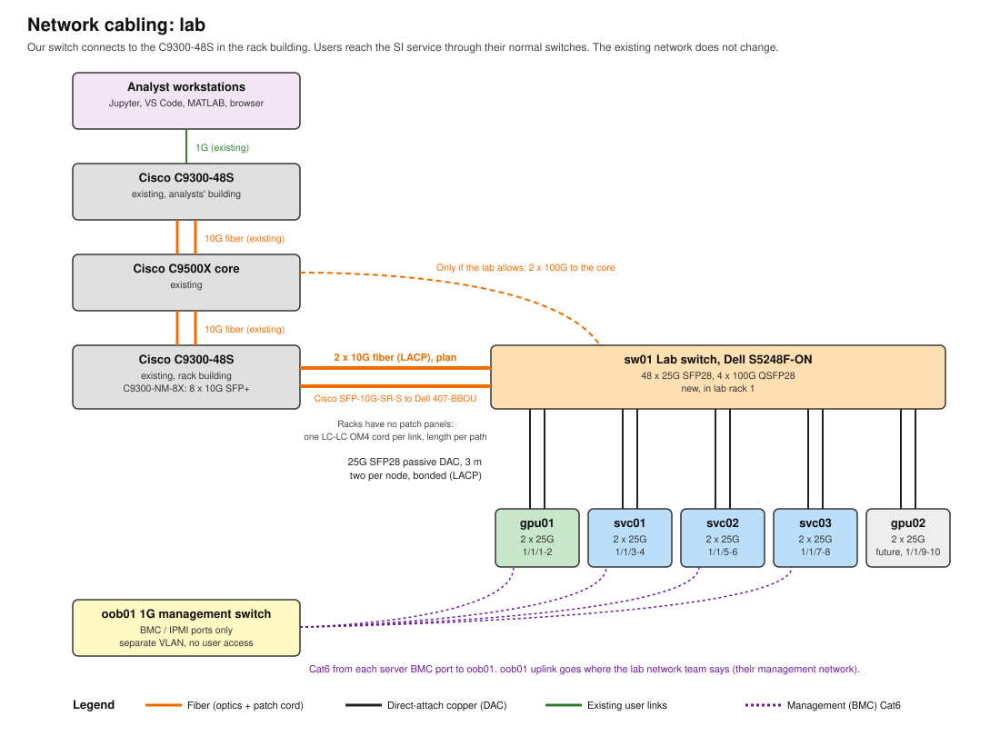

# 03. Network and switch capacity



## 1. What the lab told us

- The lab is installing a **Cisco C9500X-28C8D** core above rows 2 and 3 (28 x 100G QSFP28, 8 x 400G
  QSFP-DD). It runs IOS XE 17.15.06 (the lab tracks the second-latest Cisco MD release).
- Our switch connects directly to it at 100G, and we supply the optics for both ends (2026-11-04).
- Its own uplink to the rest of the lab network is 10G. Analysts reach our rack through the lab network
  and that uplink.
- Lab fiber is single-mode with LC connectors. The only patch panels are in the middle rack of rows 2
  and 3, for fiber back to the main building. Our racks have none (2026-11-05).
- Older notes mention C9300-48S access switches. For this design we assume they are not in our path:
  the C9500X-28C8D is the only lab switch we connect to.

## 2. Is 10G enough? For the SI phase, yes, by a wide margin

The language model runs on our GPU server, in our rack. What crosses the lab network is text going in and
text coming out. Rough numbers:

| Traffic | Size | 50 users at peak | Notes |
|---|---|---|---|
| Chat prompt + streamed answer | 10 to 200 KB per request | under 10 Mbps total | Streaming sends tokens as small chunks. |
| Large document pasted or uploaded | 1 to 50 MB, now and then | bursts, under 1 s at 1G | Limited by the user's own 1G desk port, not the 10G uplink. |
| Voice note for transcription | 1 to 10 MB | negligible | |
| Model weights | about 65 GB | **0 on the lab network** | Loaded from local NVMe in the GPU server. |
| Cluster-internal traffic (gateway to GPU, database) | moderate | stays inside sw01 | Never touches the C9500X-28C8D. |

The narrowest link users cross is the C9500X-28C8D's 10G uplink. 10G carries about 1,250 MB/s. Fifty users chatting use well under 1% of it.

**Where capacity does matter:**

1. **Inside our rack (east-west).** The gateway, chat page, and database on the service nodes talk to
   the GPU server constantly. That is why the BOM has its own 25G switch (sw01). This traffic never
   leaves the rack.
2. **Later pipeline phases, maybe.** If a later phase moves large test data sets into the rack, 10G
   could become the limit. Whether that happens depends on future pipeline scope, which isn't set.
   It doesn't change this purchase.
3. **Multi-server model serving.** Splitting one model across two servers needs very fast links
   (InfiniBand or RoCE at 200-400G). **We avoid this by design.** gpt-oss-120b is about 65 GB at its native
   4-bit format, so it fits on one 96 GB GPU. Adding users adds more copies of the model on more GPUs,
   not one model spread across servers.

## 3. How our rack connects (on hold, 2026-11-06)

> **On hold.** The network team now says our racks connect to a **Cisco N93180YC-FX3** access switch
> (48 x 25G SFP28, 6 x 100G QSFP28, NX-OS), not the C9500X-28C8D, which is their core. Everything inside
> our rack below stays the same; only the uplink's far end, speed (100G or 25G), fiber, and optics change.
> Questions: [10](10-lab-network-team-email.md), round 3. The design below is the 2026-11-05 version.

```
LAB
  C9500X-28C8D (lab core, above rows 2 and 3)
     |  2 x 100G, single-mode LC fiber, 20 m each, bonded (LACP)
     |  carries two VLANs: data, and management
OUR RACK (next to ACE 15, row 4)
  sw01  Dell S5248F-ON (fast switch)
     |-- gpu01   2 x 25G data
     |-- svc01   2 x 25G data
     |-- svc02   2 x 25G data
     |-- svc03   2 x 25G data
     |-- oob01   1 x 10G (management switch uplink)
           |
         oob01  Cisco C1300-24T-4X (management switch)
           |-- gpu01 BMC   1G copper
           |-- svc01 BMC   1G copper
           |-- svc02 BMC   1G copper
           |-- svc03 BMC   1G copper
           |-- sw01 management port
```

In plain words:

1. Our rack connects to the lab in one place: two 100G fibers from sw01 to the C9500X-28C8D.
2. Inside the rack, every server's data ports go to sw01.
3. Every server's BMC port (its built-in remote management: power, screen, reinstall) goes to oob01,
   and oob01 plugs into sw01.
4. Data traffic and management traffic share the two 100G links, kept apart as two VLANs.
5. What we need from the lab: 2 x 100G ports on the C9500X-28C8D, two VLANs (data and management), and
   an IP subnet for each.

**Parts.** The network quote request ([08b](08b-quote-network-and-rack.md)) lists them as items 6a-6g.

- **100G uplink (6a-6d):** 2 x Cisco QSFP-100G-CWDM4-S in the C9500X-28C8D, 2 x Dell 100GBASE-CWDM4
  QSFP28 in sw01, and 3 x 20 m LC-LC duplex OS2 single-mode cords (2 used, 1 spare). CWDM4 runs up to
  2 km on single-mode; LR4 is the fallback if Cisco's matrix lacks CWDM4 for this switch.
- sw01 (S5248F-ON) has 4 x 100G QSFP28 ports. Two go in one LACP port-channel to the C9500X-28C8D,
  trunking the data and management VLANs.
- **Management uplink (6e-6g):** oob01's 10G SFP+ port to sw01 port 1/1/48 (SFP28 ports accept 10G
  SFP+): one Cisco SFP-10G-SR-S in oob01, one Dell 407-BBOU in sw01, one 3 m LC-LC OM4 cord. It stays
  inside the rack, so multimode is fine.
- **Coding:** Cisco-coded optics in Cisco switches, Dell-coded optics in sw01. Check the Cisco
  optics-to-device compatibility matrix for the C9500X-28C8D at 17.15 and the next MD release.

**Why management goes through sw01.** The C9500X-28C8D has only 100G and 400G ports. Giving oob01 its own
link there would use a third 100G port for kilobits of traffic, plus an adapter, two optics, and another
20 m cord. A bigger management switch would not help: only one with 100G uplinks could plug in natively.

**The trade-off.** If sw01 or both 100G links fail, remote BMC access goes with them. Recovery is local:
the rack console (con01) and a serial cable to sw01. If the lab later requires a separate management path,
oob01 can move to its own link without changing anything else in the rack.

**Not recommended:** plugging the GPU server straight into a lab switch port. The service nodes then
reach the GPU over the lab network, and the network team has to support our east-west traffic.

## 4. InfiniBand (BOM tab, cell B21)

Not needed. InfiniBand is for spreading training or one large model across many servers. This design
serves one model copy per GPU and does no multi-node training. 25GbE inside the rack is enough.
If multi-node fine-tuning ever becomes a requirement, revisit it then. The rack has room and power for it.

## 5. Checking switch capacity: steps for the network team

These are read-only commands. Ask the lab network team to run them (we should not have access to their
switches) and send back the output. `validate/net-test.sh` runs the matching tests from our side.

**On the C9500X-28C8D:**

```
show version
show inventory
show interfaces status
show etherchannel summary
show interfaces <uplink-interface> | include rate|drops|errors
show platform resources
```

What to look for:

| Output | Question it answers | Healthy |
|---|---|---|
| `show inventory` | Exact model, network modules, optics present | Model numbers to put in our docs |
| `show interfaces status` | Free ports and their speeds | 2 free 100G QSFP28 ports |
| `... include rate` (5-minute rate) on its 10G uplink | Current load at a busy time of day | Under 50% of 10 Gbps |
| `... include drops\|errors` | Congestion or bad optics | Output drops and CRC errors near 0 and not climbing |
| `show etherchannel summary` | After we connect: are our two 100G links bonded (200G total) or is one a standby? | Both members flagged `P` (bundled) |

**End-to-end test, after our rack is connected:**

1. From one analyst workstation, run `iperf3 -c <svc01-ip> -P 4 -t 30`. Expect close to the desk port
   speed (about 940 Mbps on a 1G port).
2. From two or three workstations in different parts of the lab at once, confirm each still gets close to
   its desk speed.
3. Inside the rack (`validate/net-test.sh`): node to node should reach about 23 Gbps per 25G link.
4. Load test: run `validate/llm-load-test.py --users 10`. Ten parallel users is the 50-user peak from the BOM.
   Time-to-first-token should stay under about 2 s.
