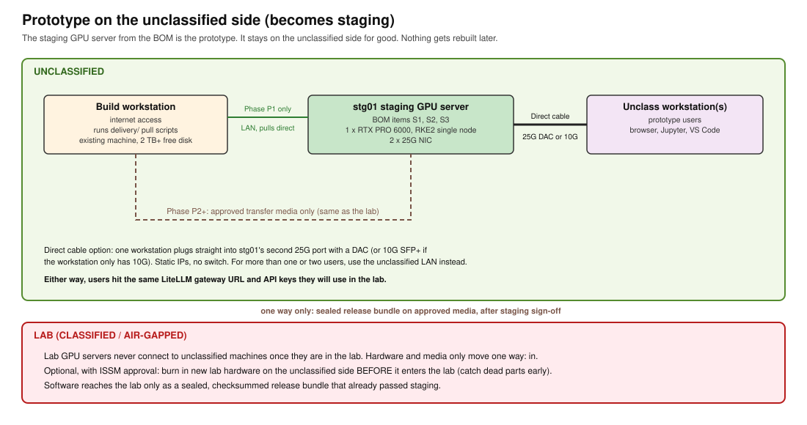

# 04. Prototype plan

## 1. The short answer

**The prototype is the lab rack, and it is treated as production from day 1.** Users already have AI on
the unclassified side, so the goal is AI inside the lab. A separate group orders the equipment, and the
work happens in the server room.

**Plan for no internet during the build.** Unless the ISSM says otherwise ([07](07-open-questions.md), L5),
all software arrives on transfer media. A connected **build workstation** on the unclassified side does the
downloading. It runs the scripts in `delivery/`, which write one checked bundle to the transfer drive.
Any connected Linux machine with about 2 TB free disk will do; it doesn't need to be bought.

**Staging server (BOM S1-S3).** It stays in the BOM. Its job is to rehearse each install and update before
it reaches the lab. Where it lives, and whether it gets internet, is a question for the ISSM
([09](09-site-visit-checklist.md)). If it can sit on the unclassified side with internet, that is where
debugging is easiest.

**About "direct connect to the GPUs":** with no internet, the direct cable doesn't change much. It is
only useful for one person testing on the staging server, on the unclassified side (section 4). It is
**not** allowed for the lab GPU servers. Lab hardware must never be connected to unclassified
machines. Hardware and media only move one way (into the lab). Check the exact rules with the lab ISSM
(see [07-open-questions.md](07-open-questions.md), S1-S3).

## 2. Why this order works

| Concern | How the plan handles it |
|---|---|
| Getting AI in users' hands quickly | Staging hardware arrives first and is used right away on the unclassified side |
| Nothing throw-away | Same server, same Kubernetes (RKE2), same Helm values, same gateway URL pattern, same scripts. Only the network location changes. |
| Learning the install before the lab | Every install problem shows up on staging first, where we have internet access and room to debug |
| Proving the air-gap process | From phase P2, staging only gets software through the same transfer bundle the lab will use |
| Dead parts | New lab hardware can be burned in on the unclassified side before it goes in (if the ISSM allows), so dead parts are caught before they reach the lab |

## 3. Phases

### P0. Order and prepare (week 0)

- [ ] Send [01-facility-requirements.md](01-facility-requirements.md) to the lab.
- [ ] Send [08-quote-request-email.md](08-quote-request-email.md) to purchasing. Order lab and staging hardware in the same
      PO or right after. GPU lead times can run long.
- [ ] Pick a build workstation on the unclassified side: Linux x86_64, internet access, about 2 TB
      free disk. An existing machine is fine.
- [ ] Get a Platform One account (Iron Bank images need one; BOM `Software` tab).

### P1. Connected prototype (staging server has internet)

The fastest way to working AI, while still using the production layout.

- [ ] Rack and cable stg01 using [05-rack-build-guide.md](05-rack-build-guide.md) (one server, one or
      two PDUs, no switch needed).
- [ ] Run `validate/hw-check.sh --gpus 1`. Expected GPU count (staging 1, lab gpu01 2)?
      NVMe present? NICs at 25G?
- [ ] Install the OS. Use the same OS and version the lab will run (ask: [07-open-questions.md](07-open-questions.md), L1).
- [ ] Run the delivery scripts **on stg01 itself, or on the build workstation**. `delivery/pull-all.sh`
      produces a release bundle.
- [ ] Install from that bundle, exactly as the lab will: `delivery/intake/verify.sh`, then
      `delivery/intake/deploy.sh`.
- [ ] Unclassified users connect through the unclassified LAN, or one user over the direct cable:
  - Chat page: `https://<stg01>/`
  - API for Jupyter, VS Code, MATLAB: `https://<stg01>/v1` with a LiteLLM key
- [ ] Collect feedback and usage logs. These replace the BOM's "20% at peak" planning figure
      (`Assumptions!B7`) with real numbers.

### P2. Air-gapped staging (rehearsal)

- [ ] Disconnect stg01 from the internet. From now on the build workstation does all pulling.
- [ ] Every update now goes: build workstation, then transfer media, then stg01. This is the exact path the
      lab will use. Missing dependencies show up here, as the Delivery view says ("Missing dependencies fail here").
- [ ] Do one full rebuild of stg01 from bare metal using only the bundle. If it works, the lab install will work.

### P3. Lab install

- [ ] Optional, with ISSM approval: burn in gpu01, svc01-03, and sw01 on the unclassified side for 24-48 h
      using `validate/hw-check.sh --burn`. Then wipe the drives and move the hardware into the lab. One way only.
- [ ] Rack and cable in the lab using [05-rack-build-guide.md](05-rack-build-guide.md).
- [ ] Carry in the same release bundle that passed staging sign-off. Run verify, then deploy.
- [ ] Run `validate/net-test.sh` and the checks in [03-network-and-switch-capacity.md](03-network-and-switch-capacity.md), section 5.

### P4. Rest of the pipeline (later)

The platform is the same one the full architecture (`metrics_architecture.html`) uses. Big Bang (Harbor,
GitLab, Argo CD, Keycloak, monitoring) and the metrics pipeline go on top of it. They do not replace it.

## 4. Direct cable option (one workstation, unclassified only)

When only one person is prototyping, or the unclassified LAN can't reach the server yet:

1. Cable: 25G SFP28 DAC from the workstation NIC to stg01 NIC port 2. If the workstation only has 10G,
   use an SFP+ DAC; the stg01 port will run at 10G.
2. Static addresses on a private point-to-point subnet, for example:
   - stg01 port 2: `192.168.250.1/30`
   - workstation: `192.168.250.2/30`
3. Workstation reaches the gateway at `https://192.168.250.1/`.
4. When the LAN connection is ready, unplug the cable. Nothing else changes.

This needs a NIC in the workstation. Most desktops do not have a 25G or 10G port; a PCIe 10/25G NIC
costs about $150-400. If the workstation lacks one, use the LAN.
