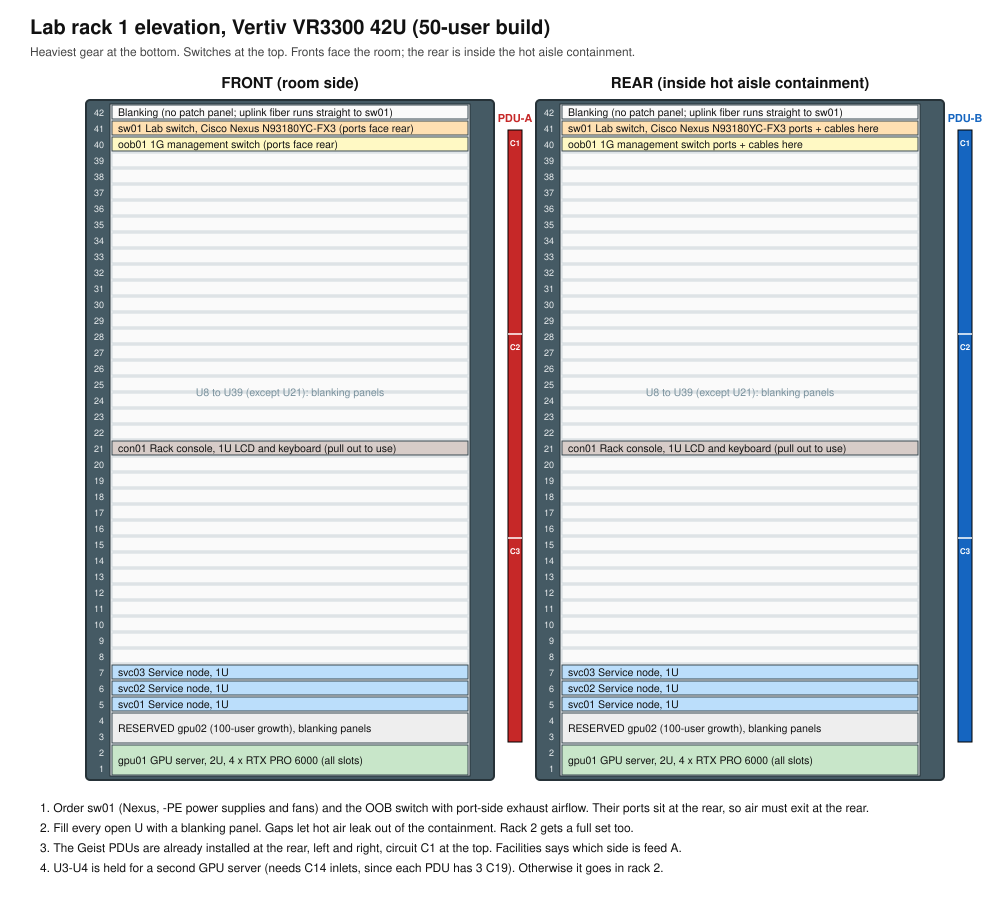
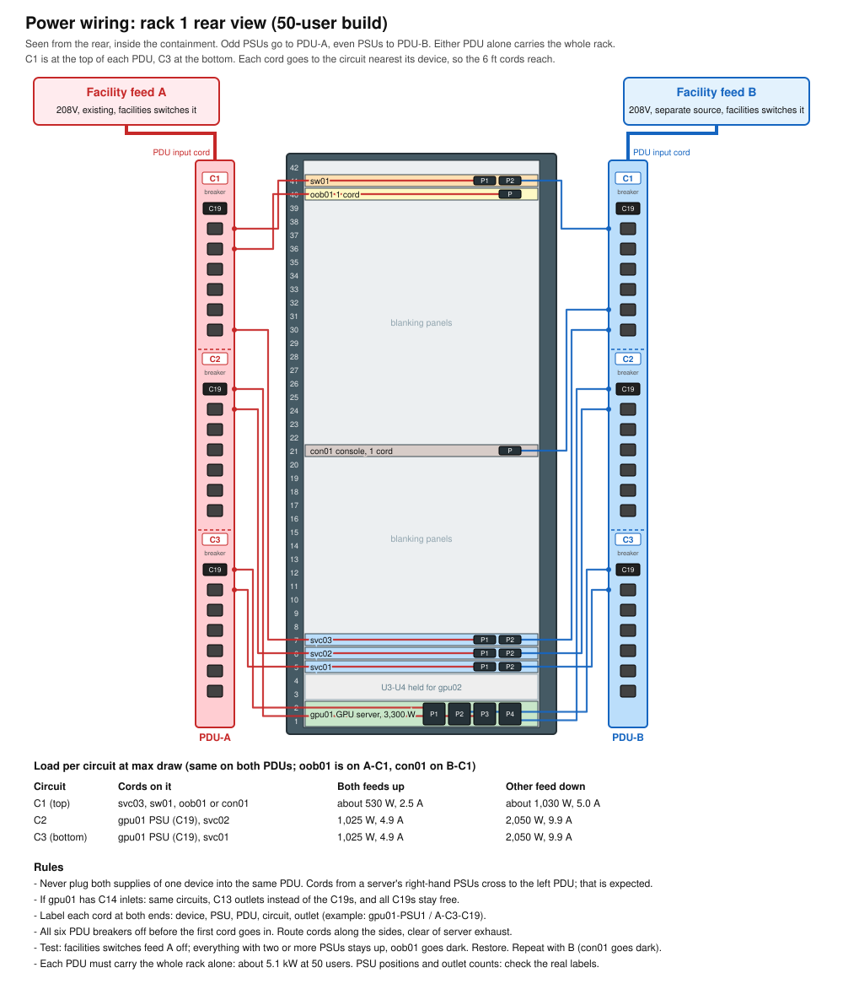
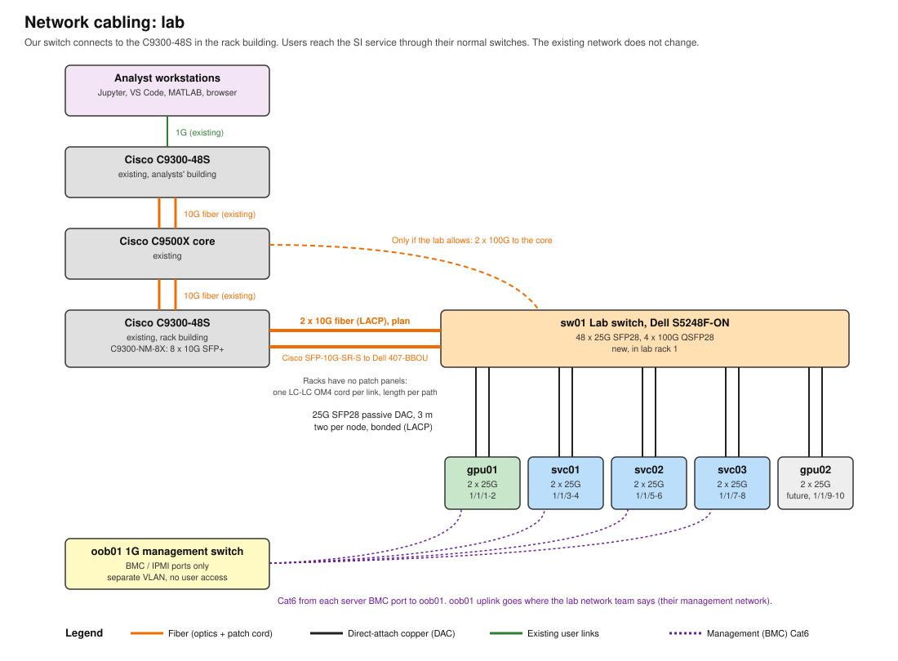

# 05. Rack build guide

Step-by-step for racking, powering, and cabling the lab rack (rack 1 of the two racks next to ACE 15).
There is no staging server; this rack is the whole build (50 users).

Site facts from visit 1 ([09](09-site-visit-checklist.md)):

- Vertiv VR3300 racks: 42U, 1200 mm deep, square holes, adjustable rails
- Vertiv Geist PDUs already mounted, left and right
- Hot aisle containment: the rear of the rack is inside the glass. That is where you work on cables and PDUs.
- No lift, crash cart, or console on site

Diagrams (open the SVG files for full size; they print well on 11x17):

- [Rack elevation](diagrams/rack-elevation.svg)
- [Power wiring](diagrams/power-wiring.svg)
- [Network cabling](diagrams/network-cabling.svg)

**Practice first:** [training/rack1-install-sim.html](../training/rack1-install-sim.html) walks through every
step below in order, with the real part numbers, U positions, outlets, and ports. Open it in any browser.
It needs no network.

## 0. Vendor guides and videos

Use the vendor's own document for each step that touches their hardware. No official install videos
were found for the exact models in this build, so the vendor PDFs are the primary reference. Ask
Thinkmate whether they offer an install walkthrough with the order.

| Hardware | Official guide | What to read |
|---|---|---|
| Vertiv VR3300 rack | VR Rack Installer/User Guide, SL-11425: https://www.vertiv.com/globalassets/shared/sl-11425_rev0.pdf. Product page: https://www.vertiv.com/en-ca/products-catalog/facilities-enclosures-and-racks/racks-and-containment/vr3300/ | 4.6 rails, 4.9 grounding |
| Vertiv Geist rack PDU (already installed) | Vertiv rPDU and VR rack integration flyer: https://www.vertiv.com/49bd35/globalassets/shared/vertiv-rpdu-vr-rack-integration-flyer.pdf. For the full manual, search the model number from the PDU label on vertiv.com. | Outlet and circuit layout, display |
| Liebert CRV (the CR035RA unit) | Liebert CRV design manual: https://www.vertiv.com/globalassets/products/thermal-management/in-row-cooling/liebert-crv-row-based-cooling-system-design-manual.pdf | Facility's job, for reference only |
| Cisco Nexus N93180YC-FX3 | Cisco Nexus 93180YC-FX3 NX-OS Mode Switch Hardware Installation Guide (search the title on cisco.com) | 4-post rack-mount kit, airflow (port-side exhaust), power, console |
| Thinkmate GPU server and service nodes | Ships with a quick-start and rail kit sheet. Ask Thinkmate for the motherboard and chassis manuals when you order. | Rails, GPU install, PSU, BMC first login |
| StarTech RKCONS1701 rack console | https://www.startech.com/en-us/server-management/rkcons1701 (manual under Support) | Rail and cage nut install |
| NVIDIA RTX PRO 6000 Server Edition | Server Edition product brief (NVIDIA site, PDF) | Passive card, 16-pin power, 400-600 W setting |

For video, search YouTube with the exact model number (for example "Vertiv VR3300 rail install" or
"Nexus 93180YC-FX3 rack install"). Watch the vendor's own channel first. Generic "server rail install" videos
work fine for the sliding-rail steps, which are the same on almost every 2U server.

## 1. Before you start

**Tools:** the setup kit in the quote request ([08b](08b-quote-network-and-rack.md), item 12) and the rack
console (item 11). Use velcro, not zip ties.

**People:** two people for the GPU server. Never lift it alone.

**Check the delivery against the BOM:**

- [ ] gpu01: 4 GPUs installed (or loose in boxes), 2 x 3.84 TB NVMe, dual-port 25G NIC, rail kit, power cords
- [ ] svc01, svc02, svc03: rail kits, cords
- [ ] sw01 Nexus N93180YC-FX3: airflow is **port-side exhaust**. The power supplies read NXA-PAC-650W-**PE**
      and the fans NXA-FAN-35CFM-**PE** (Cisco codes port-side exhaust blue; -PI is intake, burgundy).
      **If it is wrong, stop and swap it.** Don't install it.
- [ ] oob01 management switch
- [ ] Rack console (StarTech RKCONS1701) with its VGA/USB cable, rails, and cage nuts
- [ ] Power cords: C13-to-C14 for service nodes and switches; C13-to-C14 or C19-to-C20 for the GPU server (no wall-plug cords)
- [ ] 10 x Cisco SFP-H25G-CU3M 25G DAC, 3 m (8 used now, 2 spare)
- [ ] 100G data links: 4 x Cisco QSFP-40/100-SRBD (2 per end)
- [ ] Management link: 1 x Cisco CVR-QSFP-SFP10G adapter, 2 x Cisco SFP-10G-SR-S
- [ ] Fiber cords, LC-LC OM4 multimode (aqua): 3 x 8 m, 3 x 15 m (data and management; the unused length is the spare)
- [ ] Cat6 patch cables, 10 ft (3 m), 2 ten-packs (BMC and oob01 uplink, rest spare)
- [ ] Blanking panels: 80 (about 30 for rack 1, 42 for rack 2, spares)

## 2. Rack prep

1. Confirm the rack: rack 1 of the two next to ACE 15. **The front faces the room. The rear is inside the
   hot aisle containment.** Servers go in from the front, cables are done from the rear.
2. Confirm with facilities that the rack frame is bonded to facility ground (SL-11425 section 4.9).
   The green wires on the doors only bond the doors to the frame.
3. Set the 19" rails. In VR racks, the built-in rail alignment marks set the front rail position. Set the
   rear rails so the depth matches the GPU server's rail kit (the server rail is the longest; set for it).
4. The Geist PDUs are already mounted, left and right, at the rear. Once facilities says which side is
   feed A, label the left PDU and the right PDU `PDU-A` and `PDU-B` (or the other way round).
5. Check each PDU's display is on (if fitted) and every outlet is empty.

## 3. Install equipment, bottom up

Install heaviest first, at the bottom, so the rack can't tip.

| U | Item | Notes |
|---|---|---|
| 1-2 | gpu01 | Rails first, then slide the server in with two people. Confirm it latches. |
| 3-4 | (reserved gpu02) | Blanking panels for now |
| 5 | svc01 | |
| 6 | svc02 | |
| 7 | svc03 | |
| 8-20 | blanking | Install all of them before power-on |
| 21 | con01 rack console | Eye height for a seated or kneeling person. Cage nuts (square holes). |
| 22-39 | blanking | |
| 40 | oob01 | Ports to the rear |
| 41 | sw01 | Ports to the rear, power supplies and fans to the front. Cisco 4-post rack-mount kit, cage nuts. |
| 42 | blanking | No patch panel in our racks. The uplink fiber runs straight from sw01 to the lab C9500X-28C8D. |

**Rack 2** (held for growth): fill all 42U with blanking panels now, so it doesn't leak hot air from
the contained aisle.

**GPU install, if the GPUs come loose:**

1. ESD strap on. Server unplugged, out on its rails or on a bench.
2. Fill all four GPU slots, in the order the vendor marks them (GPU 1 to GPU 4).
3. Seat the card fully. Fasten the bracket. Connect the 16-pin power cable until it clicks. A half-seated
   16-pin connector is the most common failure on 600 W cards: **push it in until there is no gap.**
4. Check all four 16-pin connectors again: no gap on any of them.
5. Install the air shroud or baffle the vendor supplies. Passive GPUs overheat without it.

## 4. Power cabling

**What A and B mean.** Each rack has two Geist PDUs, one left and one right. If facilities feeds them
from separate sources (A and B), losing one source leaves the other PDU running. Every server has two
or more power supplies, each with its own cord. Half of a server's cords go to the left PDU and half to
the right. Then if feed A fails, everything keeps running on B. Pictures of this:

- Oracle server guide, dual power feed: https://docs.oracle.com/cd/E55211_01/html/E55213/gqcnz.html
- Austin Hughes, A and B PDUs in a rack: https://www.austin-hughes.com/solutions/infrapower/dual-feed-pdu/

**How you know which is A and which is B.** The PDUs are not marked. Facilities knows which upstream
panel and breaker feed each one. Ask them ([09](09-site-visit-checklist.md)), then label the PDUs.

**Circuits on each PDU.** Each PDU has circuits 1, 2, and 3. Each circuit has its own breaker on the PDU,
mostly C13 outlets, and one C19. On a 3-phase PDU, each circuit is one phase pair.
On the site's PDUs, circuit 1 is at the top, nearest the switches, and circuit 3 is at the bottom, nearest
gpu01. The plan keeps every cord on the circuit closest to its device, so the 6 ft cords reach.

0. **Before plugging anything in:** facilities confirms that the upstream feeds to both PDUs are off and
   locked out per the lab's lockout/tagout process, or confirms in writing that plugging in with the
   PDUs live is their normal practice. Check every PDU circuit breaker is switched off.
1. Label every cord at both ends **before** plugging in: `gpu01-PSU1 / A-C3-C19`, and so on.
2. Plug every device's odd-numbered PSU into PDU-A and its even-numbered PSU into PDU-B. **Never put
   both PSUs of one device on the same PDU.** The GPU server has 4 PSUs: PSU1 and PSU3 to A, PSU2 and PSU4 to B.
3. Spread the load across the PDU's three circuits. Plan for each PDU:
   - Circuit 1 (top): svc03, sw01, and oob01 or the console (one on each PDU)
   - Circuit 2 (middle): gpu01 PSU (C19 if C20 cords, else a C13), svc02
   - Circuit 3 (bottom): gpu01 PSU (C19 if C20 cords, else a C13), svc01

   After power-on, the PDU display shows the current on each circuit. If one is much higher than the
   others, move a cord to a lighter circuit.
4. Do the network cabling (section 5) now, while the rack is cold. Then facilities removes the lockout.
   Switch the PDU circuit breakers on.
5. Power on in this order: switches, then service nodes, then gpu01.
6. **Feed test:** with everything running, facilities switches feed A **off** upstream. Everything with two
   or more PSUs must stay up on PDU-B. oob01 and con01 have one cord each, so the one on feed A goes off.
   That is expected. Facilities switches A back on. Wait 2 minutes, then repeat with feed B off. Same result.
   Record the current on each circuit from each PDU display. Only facilities switches the upstream feeds.
7. Close the hot aisle containment doors when you finish. Cable work at the rear is done before power-on,
   because the contained aisle gets hot once the servers run.

## 5. Network cabling

### Cable schedule

Label each cable at both ends with its ID.

| ID | From | To | Cable | Purpose |
|---|---|---|---|---|
| D01 | gpu01 NIC port 1 | sw01 Ethernet1/1 | Cisco SFP-H25G-CU3M DAC | data, bond member 1 |
| D02 | gpu01 NIC port 2 | sw01 Ethernet1/2 | Cisco SFP-H25G-CU3M DAC | data, bond member 2 |
| D03 | svc01 NIC port 1 | sw01 Ethernet1/3 | Cisco SFP-H25G-CU3M DAC | data |
| D04 | svc01 NIC port 2 | sw01 Ethernet1/4 | Cisco SFP-H25G-CU3M DAC | data |
| D05 | svc02 NIC port 1 | sw01 Ethernet1/5 | Cisco SFP-H25G-CU3M DAC | data |
| D06 | svc02 NIC port 2 | sw01 Ethernet1/6 | Cisco SFP-H25G-CU3M DAC | data |
| D07 | svc03 NIC port 1 | sw01 Ethernet1/7 | Cisco SFP-H25G-CU3M DAC | data |
| D08 | svc03 NIC port 2 | sw01 Ethernet1/8 | Cisco SFP-H25G-CU3M DAC | data |
| (D09-D10) | reserved gpu02 | sw01 Ethernet1/9-1/10 | | future |
| U01 | sw01 Ethernet1/49 (Cisco QSFP-40/100-SRBD) | lab C9500X-28C8D, port assigned by the lab (Cisco QSFP-40/100-SRBD) | LC-LC OM4, 8 m or 15 m | data uplink, bond member 1 |
| U02 | sw01 Ethernet1/50 (Cisco QSFP-40/100-SRBD) | lab C9500X-28C8D, port assigned by the lab (Cisco QSFP-40/100-SRBD) | LC-LC OM4, 8 m or 15 m | data uplink, bond member 2 |
| M01 | gpu01 BMC | oob01 port 1 | Cat6 3 m | management |
| M02 | svc01 BMC | oob01 port 2 | Cat6 3 m | management |
| M03 | svc02 BMC | oob01 port 3 | Cat6 3 m | management |
| M04 | svc03 BMC | oob01 port 4 | Cat6 3 m | management |
| M05 | sw01 mgmt0 port | oob01 port 5 | Cat6 3 m | management |
| M06 | oob01 SFP+ port 1 (Cisco SFP-10G-SR-S) | lab C9500X-28C8D, third port assigned by the lab (CVR-QSFP-SFP10G + Cisco SFP-10G-SR-S) | LC-LC OM4, 8 m or 15 m | management uplink |

Check sw01 port numbering on the faceplate. NX-OS names the SFP28 ports `Ethernet1/1` to `Ethernet1/48` and
the QSFP28 ports `Ethernet1/49` to `Ethernet1/54`.

### Steps

1. Run DACs along the side of the rack in velcro bundles. Don't bend them tighter than about a 5 cm radius.
2. Fiber: keep the dust caps on until you plug in. Clean each connector with a one-click cleaner first.
   U01, U02, and M06 are all multimode (aqua) LC. All three run directly to the lab C9500X-28C8D along
   the route the lab network team gives. Use the 8 m cords if they reach with slack,
   otherwise the 15 m ones; coil spare length at our end.
3. Plug BMC Cat6 last so it doesn't get buried.
4. Install the rear door. Check that no cable bundle blocks server exhaust.

## 6. First power-on checks

1. **Switch:** console in, set the management IP, then confirm `show interface status` shows each D-cable
   link up at 25G. Enable `feature lacp` and put Ethernet1/49-1/50 in one LACP port-channel (VLAN plan from
   the lab); check with `show port-channel summary`. oob01's uplink (M06) goes to the lab directly, not through sw01.
2. **BMC:** each server's BMC gets an IP (DHCP or set at the BIOS screen using the rack console). Change the
   default password at first login. Record it in the lab's approved password store.
   **Set the BMC LAN mode to Dedicated** on every server (BIOS setup, or `ipmitool raw 0x30 0x70 0x0c 1 0`
   on Supermicro-based boards). Many server boards ship in *Failover* or *Shared* mode: if the BMC port has
   no link at power-on, the BMC moves onto the onboard RJ45 data port and stays there. The onboard RJ45
   ports (gpu01: 2 x 10GbE, each service node: 1 x 1GbE) stay unplugged in this design.
3. **BIOS settings on gpu01**:
   - Above 4G decoding: on
   - Resizable BAR: on
   - SR-IOV: on
   - IOMMU: on
   - Power profile: performance
   - Boot mode: UEFI
   - Secure Boot: per lab policy. With Secure Boot on, the NVIDIA driver must be signed, so tell the
     software team.
4. Install the OS, then run `validate/hw-check.sh --gpus 4`. It checks:
   - GPU count, and that each GPU is on PCIe Gen5 x16
   - GPU temperature and power limit
   - NVMe drives present
   - NIC link speed
5. Run `validate/net-test.sh` between nodes.
6. Take photos of the front and rear of the finished rack, and of each PDU display under load. Add them to
   `docs/photos/` (the as-built record).

## 7. Sign-off

- [ ] Feed A / feed B test passed
- [ ] All D-links up at 25G, both 100G uplinks up and in a port-channel, oob01 uplink (M06) up at 10G to the C9500X-28C8D
- [ ] `hw-check.sh` passed on every node
- [ ] All empty U blanked, rear door on, cold-aisle intake in range
- [ ] Cable labels match this schedule
- [ ] Photos added
