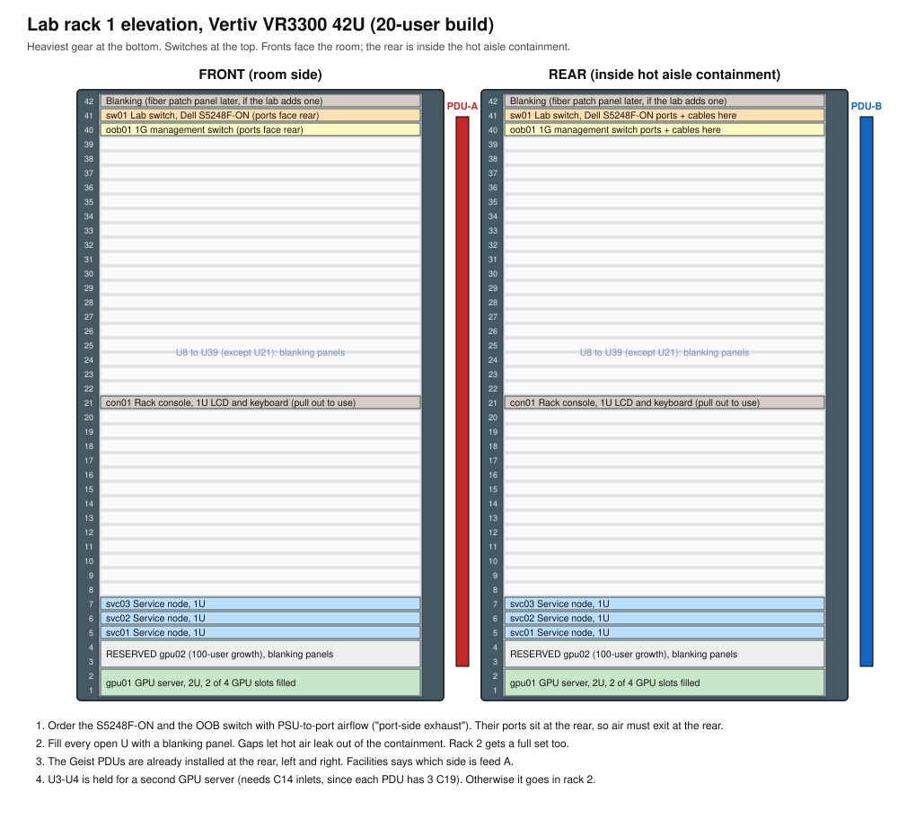
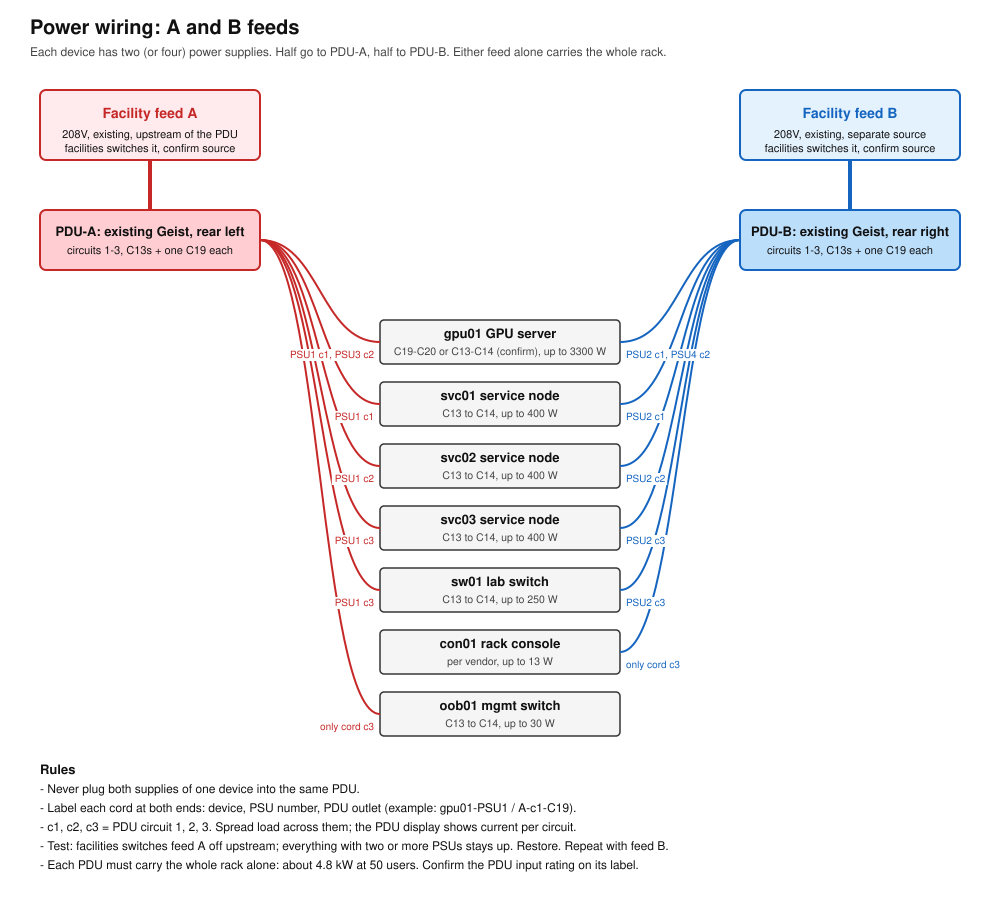
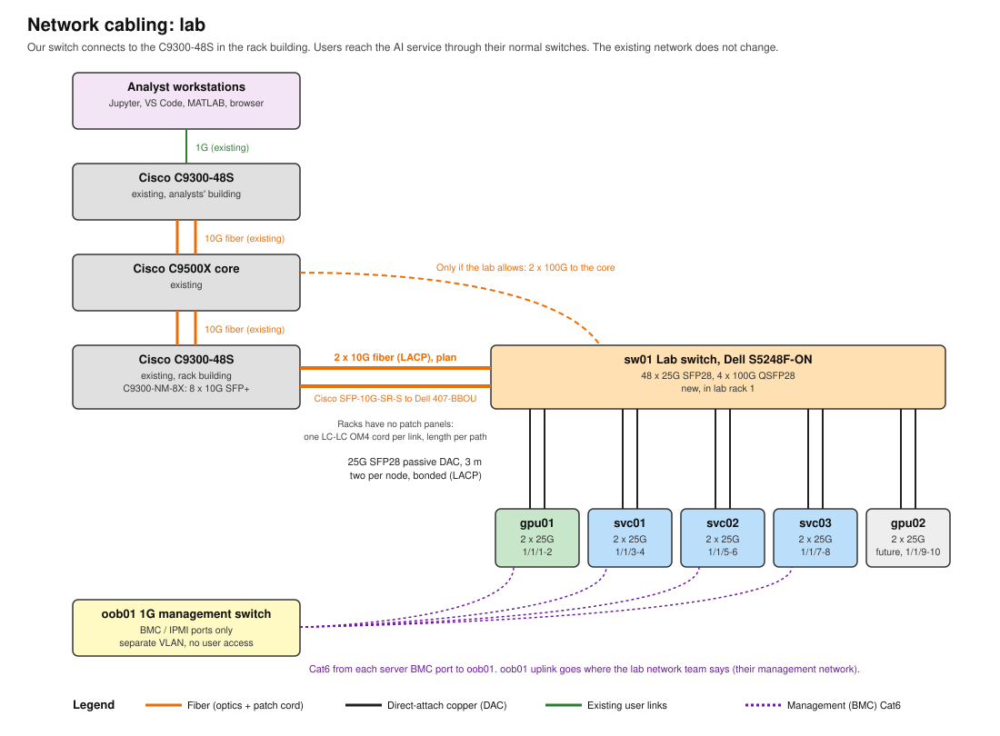

# 05. Rack build guide

Step-by-step for racking, powering, and cabling the lab rack. Staging is the same with one server and
no switches (see [04-prototype-plan.md](04-prototype-plan.md), section 4).

Diagrams (open the SVG files for full size; they print well on 11x17):

- [Rack elevation](diagrams/rack-elevation.svg)
- [Power wiring](diagrams/power-wiring.svg)
- [Network cabling](diagrams/network-cabling.svg)

## 0. Vendor guides and videos

Use the vendor's own document for each step that touches their hardware. No official install videos
were found for the exact models in this build, so the vendor PDFs are the primary reference. Ask
Thinkmate whether they offer an install walkthrough with the order. Vertiv offers to pre-install Geist
PDUs in VR racks before shipment (per the integration flyer below), though our racks are already on site.

| Hardware | Official guide | What to read |
|---|---|---|
| Vertiv VR rack | VR Rack Installer/User Guide, SL-11425: https://www.vertiv.com/globalassets/shared/sl-11425_rev0.pdf | 4.6 rails, 4.7 PDU mounting, 4.9 grounding |
| Vertiv Geist rack PDU | Vertiv rPDU and VR rack integration flyer: https://www.vertiv.com/49bd35/globalassets/shared/vertiv-rpdu-vr-rack-integration-flyer.pdf. Full manual ships in the PDU box. | Tool-less button mounting in the 0U space |
| Liebert CRV (the CR035RA unit) | Liebert CRV design manual: https://www.vertiv.com/globalassets/products/thermal-management/in-row-cooling/liebert-crv-row-based-cooling-system-design-manual.pdf | Facility's job, for reference only |
| Dell S5248F-ON | S5200F-ON Series Installation Guide: https://www.dell.com/support/manuals/en-us/networking-s5224f-on/s5200-on_install_pub/about-this-guide | ReadyRails 1U tool-less square-hole install, power, airflow |
| Thinkmate GPU server | Ships with a quick-start and rail kit sheet. Ask Thinkmate for the motherboard and chassis manuals when you order. | Rails, GPU install, PSU, BMC first login |
| NVIDIA RTX PRO 6000 Server Edition | Server Edition product brief (NVIDIA site, PDF) | Passive card, 16-pin power, 400-600 W setting |

For video, search YouTube with the exact model number (for example "Vertiv VR3300 rail install" or
"S5248F-ON rack install"). Watch the vendor's own channel first. Generic "server rail install" videos
work fine for the sliding-rail steps, which are the same on almost every 2U server.

## 1. Before you start

**Tools:** #2 Phillips, cage-nut tool (if the rack uses cage nuts), label maker, velcro (not zip ties),
flashlight, ESD wrist strap, laptop with USB crash-cart adapter (BOM addition A7), console cable
(USB-C or RJ45-to-USB) for the switches.

**People:** two people for the GPU server. Never lift it alone.

**Check the delivery against the BOM:**

- [ ] gpu01: 2 GPUs installed (or loose in boxes), 2 x 3.84 TB NVMe, dual-port 25G NIC, rail kit, power cords
- [ ] svc01, svc02, svc03: rail kits, cords
- [ ] sw01 S5248F-ON: airflow is **PSU-to-port (port-side exhaust)**. Check the fan and PSU handle color
      against the Dell guide. **If it is wrong, stop and swap it.** Don't install it.
- [ ] oob01 management switch
- [ ] 2 x rack PDU (PDU-A, PDU-B)
- [ ] 10 x 25G SFP28 DAC, 3 m (8 used now, 2 spare)
- [ ] Uplink optics and fiber patch cords (option A or B from [03](03-network-and-switch-capacity.md))
- [ ] Cat6 patch cables, 6 x 3 m (BMC and oob01 uplink)
- [ ] Blanking panels for about 32U

## 2. Rack prep

1. Confirm the rack's position in the row. **Front door faces the cold aisle.**
2. Confirm the rack is grounded to the facility ground bar. Use the rack's ground stud (SL-11425
   section 4.9). Ground the rack before anything else.
3. Set the 19" rails. In VR racks, the built-in rail alignment marks set the front rail position. Set the
   rear rails so the depth matches the GPU server's rail kit (the server rail is the longest; set for it).
4. Mount **PDU-A on the rear left** and **PDU-B on the rear right**, in the 0U channels. Face the outlets
   toward the center so cords don't block the server exhaust.
5. Route the PDU input cords up or down to the L21-30R receptacles. **Leave them unplugged.**

## 3. Install equipment, bottom up

Install heaviest first, at the bottom, so the rack can't tip.

| U | Item | Notes |
|---|---|---|
| 1-2 | gpu01 | Rails first, then slide the server in with two people. Confirm it latches. |
| 3-4 | (reserved gpu02) | Blanking panels for now |
| 5 | svc01 | |
| 6 | svc02 | |
| 7 | svc03 | |
| 8-39 | blanking | Install all of them before power-on |
| 40 | oob01 | Ports to the rear |
| 41 | sw01 | Ports to the rear, PSUs to the front. Dell ReadyRails, tool-less. |
| 42 | Fiber patch panel | Uplink fiber lands here, then short patch to sw01 |

**GPU install, if the GPUs come loose:**

1. ESD strap on. Server unplugged, out on its rails or on a bench.
2. Use the slots the vendor marks for GPUs 1 and 2. Leave slots 3 and 4 for growth.
3. Seat the card fully. Fasten the bracket. Connect the 16-pin power cable until it clicks. A half-seated
   16-pin connector is the most common failure on 600 W cards: **push it in until there is no gap.**
4. Install the air shroud or baffle the vendor supplies. Passive GPUs overheat without it.
5. Fit slot covers or the vendor's blank fillers in the empty GPU slots.

## 4. Power cabling

1. Label every cord at both ends **before** plugging in: `gpu01-PSU1 / A-01`, and so on.
2. Plug every device's odd-numbered PSU into PDU-A and its even-numbered PSU into PDU-B. **Never put
   both PSUs of one device on the same PDU.**
3. Spread the load across the PDU's three outlet banks (phases). Suggested: gpu01 PSUs on bank 1,
   service nodes on bank 2, switches on bank 3.
4. Plug the PDU inputs into the L21-30R receptacles. Facility staff turn the breakers on.
5. Power on in this order: switches, then service nodes, then gpu01.
6. **Feed test:** with everything running, have facilities open breaker A. Everything must stay up. Close it,
   wait 2 minutes, open breaker B. Same result. Record per-phase current from the PDU display.

## 5. Network cabling

### Cable schedule

Label each cable at both ends with its ID.

| ID | From | To | Cable | Purpose |
|---|---|---|---|---|
| D01 | gpu01 NIC port 1 | sw01 1/1/1 | 25G SFP28 DAC 3 m | data, bond member 1 |
| D02 | gpu01 NIC port 2 | sw01 1/1/2 | 25G SFP28 DAC 3 m | data, bond member 2 |
| D03 | svc01 NIC port 1 | sw01 1/1/3 | 25G SFP28 DAC 3 m | data |
| D04 | svc01 NIC port 2 | sw01 1/1/4 | 25G SFP28 DAC 3 m | data |
| D05 | svc02 NIC port 1 | sw01 1/1/5 | 25G SFP28 DAC 3 m | data |
| D06 | svc02 NIC port 2 | sw01 1/1/6 | 25G SFP28 DAC 3 m | data |
| D07 | svc03 NIC port 1 | sw01 1/1/7 | 25G SFP28 DAC 3 m | data |
| D08 | svc03 NIC port 2 | sw01 1/1/8 | 25G SFP28 DAC 3 m | data |
| (D09-D10) | reserved gpu02 | sw01 1/1/9-10 | | future |
| U01 | sw01 QSFP28 uplink 1 | patch panel port 1, then C9500X | 100G optic + fiber | uplink (option A) |
| U02 | sw01 QSFP28 uplink 2 | patch panel port 2, then C9500X | 100G optic + fiber | uplink (option A) |
| M01 | gpu01 BMC | oob01 port 1 | Cat6 3 m | management |
| M02 | svc01 BMC | oob01 port 2 | Cat6 3 m | management |
| M03 | svc02 BMC | oob01 port 3 | Cat6 3 m | management |
| M04 | svc03 BMC | oob01 port 4 | Cat6 3 m | management |
| M05 | sw01 mgmt port | oob01 port 5 | Cat6 3 m | management |
| M06 | oob01 uplink | lab management network | per lab | management |

Check sw01 port numbering on the faceplate. The Dell OS10 names are `ethernet 1/1/1` to `1/1/48` for
SFP28. The QSFP28 uplink numbers vary by OS10 version, so run `show interface status` to see them.

### Steps

1. Run DACs along the side of the rack in velcro bundles. Don't bend them tighter than about a 5 cm radius.
2. Fiber: keep the dust caps on until you plug in. Clean each connector with a one-click cleaner first.
   For MPO (100G-SR4), check polarity with the network team (usually Type B trunk).
3. Plug BMC Cat6 last so it doesn't get buried.
4. Install the rear door. Check that no cable bundle blocks server exhaust.

## 6. First power-on checks

1. **Switch:** console in, set the management IP, then confirm `show interface status` shows each D-cable
   link up at 25G.
2. **BMC:** each server's BMC gets an IP (DHCP or set at the BIOS screen via the crash cart). Change the
   default password at first login. Record it in the lab's approved password store.
3. **BIOS settings on gpu01** (and stg01):
   - Above 4G decoding: on
   - Resizable BAR: on
   - SR-IOV: on
   - IOMMU: on
   - Power profile: performance
   - Boot mode: UEFI
   - Secure Boot: per lab policy. With Secure Boot on, the NVIDIA driver must be signed, so tell the
     software team.
4. Install the OS, then run `validate/hw-check.sh --gpus 2`. It checks:
   - GPU count, and that each GPU is on PCIe Gen5 x16
   - GPU temperature and power limit
   - NVMe drives present
   - NIC link speed
5. Run `validate/net-test.sh` between nodes.
6. Take photos of the front and rear of the finished rack, and of each PDU display under load. Add them to
   `docs/photos/` (the as-built record).

## 7. Sign-off

- [ ] Feed A / feed B test passed
- [ ] All D-links up at 25G, uplinks up and in a port-channel
- [ ] `hw-check.sh` passed on every node
- [ ] All empty U blanked, rear door on, cold-aisle intake in range
- [ ] Cable labels match this schedule
- [ ] Photos added
