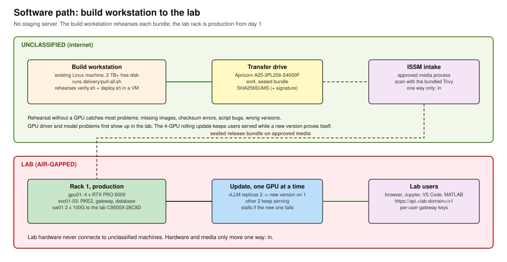

# 04. Prototype plan

**Track:** Software (building, moving, and installing the SI service). Security decisions are in the [Cyber Security package](../cyber/README.md).

## 1. The short answer

**The prototype is the lab rack, and it is treated as production from day 1.** Users already have SI on
the unclassified side, so the goal is SI inside the lab. A separate group orders the equipment, and the
work happens in the server room.

**No staging server** (decided 2026-10-30). The money it would have cost bought gpu01's third and
fourth GPUs, so the lab starts at the 50-user size ([02](../hardware/02-budget-and-bom.md)).

**Plan for no internet during the build.** Unless the ISSM says otherwise ([security decisions](../cyber/README.md), L5),
all software arrives on transfer media. A connected **build workstation** on the unclassified side does the
downloading. It runs the scripts in `delivery/`, which write one checked bundle to the transfer drive.
Any connected Linux machine with about 2 TB free disk will do; it doesn't need to be bought.

**The build workstation also rehearses each bundle**, in a virtual machine, before the bundle goes on the
transfer drive. That replaces most of what staging did. What it cannot test is anything that needs a GPU.

## 2. What staging did, and what covers it now

| Staging's job | Without staging |
|---|---|
| Catch missing images, bad checksums, script bugs | Rehearsal VM on the build workstation runs `verify.sh` and the full `deploy.sh` sequence (section 3, P1) |
| Prove the air-gap process | The rehearsal VM has no internet while it installs, so a missing dependency fails there, as the Delivery view says ("Missing dependencies fail here") |
| Test the GPU driver and model before the lab | **Not covered.** First seen in the lab. Kept small by pinning the driver to the versions in `versions.env` and changing one thing per release. |
| Keep users served during an update | gpu01 runs 3 language model copies (the fourth GPU runs Whisper). An update replaces one copy at a time, so two keep serving. A new version that never becomes ready stops the rollout by itself. |
| A place to debug with internet | **Not covered.** Debug in the lab from logs. If this hurts, see section 4. |
| Nothing throw-away | Same RKE2, Helm values, gateway URL pattern, and scripts as before. `deploy.sh --single-node` still works for a single-GPU test machine if one is added later. |

## 3. Phases

### P0. Order and prepare (week 0)

- [ ] Send [01-facility-requirements.md](../hardware/01-facility-requirements.md) to the lab. If an earlier version was
      sent, send this one: the peak draw is now about 4.8 kW, not 3.6 kW.
- [x] Send [08a](../hardware/08a-quote-servers-submitted.md) (servers and GPUs) to purchasing. Submitted 2026-11-04.
- [ ] Send [08b](../hardware/08b-quote-network-and-rack.md) (network, rack, setup) to purchasing once the uplink design is settled.
- [ ] Pick a build workstation on the unclassified side: Linux x86_64, internet access, about 2 TB
      free disk, 32 GB RAM or more (for the rehearsal VM). An existing machine is fine.
- [ ] Get a Platform One account (Iron Bank images need one; BOM `Software` tab).

### P1. Build and rehearse a release (on the build workstation)

- [ ] Run `delivery/pull-all.sh` ([06](06-software-delivery.md)). It writes the sealed bundle.
- [ ] Create the rehearsal VM: same OS and version the lab will run ([security decisions](../cyber/README.md), L1),
      8 vCPU, 32 GB RAM, 400 GB disk. **No network access from the VM.** Attach the bundle as a disk.
- [ ] In the VM, run exactly what the lab will run:
  - `./intake/verify.sh /path/to/bundle` must print PASS
  - `./intake/deploy.sh server-init`, then `models`, `platform`, and `apps --rehearsal` (with a test
    certificate from `openssl req -x509`)
  - Skip `driver` (no GPU in the VM). `--rehearsal` sets 0 language model copies, so nothing waits for a GPU.
- [ ] Expected result: `deploy.sh status` shows every pod running, and `vllm` at 0 of 0 replicas. Its image
      is still loaded into the in-cluster registry, so a missing image fails here. Any `ImagePullBackOff`
      means an image is missing from the bundle. Fix it and pull again.
- [ ] Delete the VM. Rebuild it from scratch for each release so nothing left over hides a problem.
- [ ] Copy the bundle that passed to the transfer drive.

### P2. Lab install

- [ ] Optional, with ISSM approval ([security decisions](../cyber/README.md), S2): burn in gpu01, svc01-03, and sw01 on the
      unclassified side for 24-48 h using `validate/hw-check.sh --gpus 4 --burn`. Then wipe the drives and
      move the hardware into the lab. One way only. Otherwise Thinkmate's factory burn-in (quote question 3)
      is the burn-in.
- [ ] Rack and cable in the lab using [05-rack-build-guide.md](../hardware/05-rack-build-guide.md).
- [ ] Carry in the bundle that passed rehearsal. Run verify, then the full deploy sequence
      ([06](06-software-delivery.md), section 4).
- [ ] Run `validate/hw-check.sh --gpus 4` on gpu01 and `validate/net-test.sh` between nodes.
- [ ] Run `validate/llm-load-test.py --users 10` (the 50-user peak) and the checks in
      [03-network-and-switch-capacity.md](../hardware/03-network-and-switch-capacity.md), section 5.
- [ ] Collect usage logs from the gateway. These replace the BOM's "20% at peak" planning figure
      (`Assumptions!C7`) with real numbers.

### P3. Updates

- [ ] Every update follows P1: pull, rehearse in a fresh VM, then the transfer drive.
- [ ] Keep the previous bundle on the lab side. To roll back, run `deploy.sh apps` from the previous bundle.
- [ ] Change one thing per release where possible (driver, model, or apps), so a problem has one cause.

### P4. Rest of the pipeline (later)

The platform is the same one the full architecture (`metrics_architecture.html`) uses. Big Bang (Harbor,
GitLab, Argo CD, Keycloak, monitoring) and the metrics pipeline go on top of it. They do not replace it.

The typed decision model (Clef) is part of this later phase, not phase 1. It needs architecture and
cybersecurity review first ([06](06-software-delivery.md), section 6). The hardware already has room for it.

## 4. If rehearsal is not enough

If GPU-side problems keep showing up first in the lab, add a single-GPU test machine on the unclassified
side. At CDW prices the budget has only about $11,500 left after the order, before the switch license
([02](../hardware/02-budget-and-bom.md), section 3), so this needs the GPU or government-price savings listed there. It installs
with `deploy.sh apps --single-node` (one PostgreSQL instance, one model copy, no Whisper), from the same
bundle the lab gets. Nothing in this plan changes to add it.

Lab hardware never connects to unclassified machines. Hardware and media only move one way (into the
lab). Check the exact rules with the lab ISSM ([07-open-questions.md](../cyber/README.md), S1-S3).
